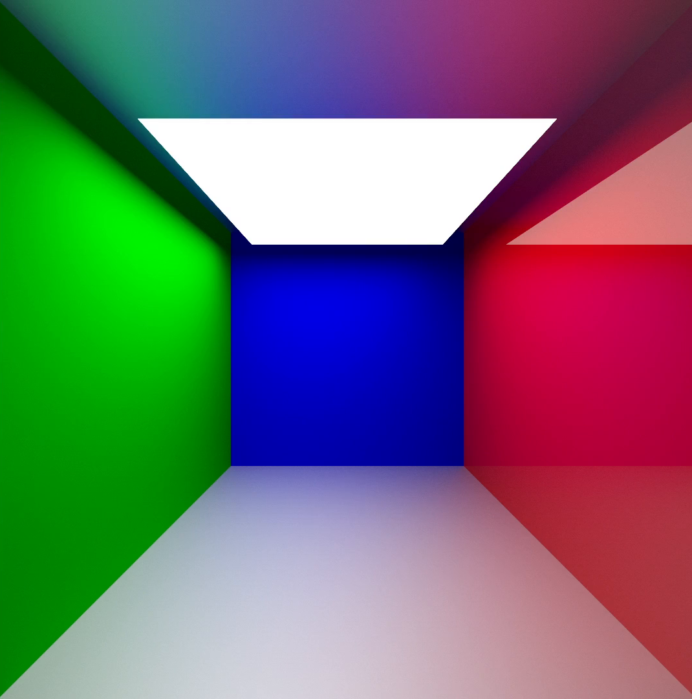

# Pathtracer

This is a simple GPU pathtracer written in C, SDL, and WebGPU that trace a simple scenes with small numbers of triangles.



## Trying it out (old)
You can try out an old CPU version of this pathtracer [here](https://duckdood.github.io/terra/pathtracer), but it doesn't run that well and it only supports spheres.

There is a demo video [here](https://duckdood.github.io/terra/pathtracer_new), but I wasn't able to get an emscripten build up and running.

## Building locally (tested with GCC)
```
git clone https://github.com/DuckDood/pathtracer.git
cd pathtracer
make
```

This needs a webgpu/webgpu.h header installed, and SDL3.

This puts a `pathtrace` binary in the build/ directory.

## Credits
I mainly used the [Ray tracing in one weekend](https://raytracing.github.io/books/RayTracingInOneWeekend.html) book and [Sebastian lague's video about ray tracing](https://www.youtube.com/watch?v=Qz0KTGYJtUk) for this project, but I also used some wikipedia relating to matrix transforms and triangle-ray intersection tests. I used [Learn WebGPU for C++ Documentation](https://eliemichel.github.io/LearnWebGPU/) for learning WebGPU.

## Technical info
It's mostly the same design as the ray tracing in one weekend book, but the light accumulation code is more similar to Sebastian Lague's video, using two variables to keep track of each ray's color rather than just one. For metallic surfaces, Sebastian Lague's video lerps between a diffuse and specular direction, whereas RT in one weekend jiggles a specular ray directly, and I decided to go with the latter, as it seems more physically based.

## AI use
I asked AI occasionally to learn WebGPU stuff like documentation or and how to use some of the functions.
