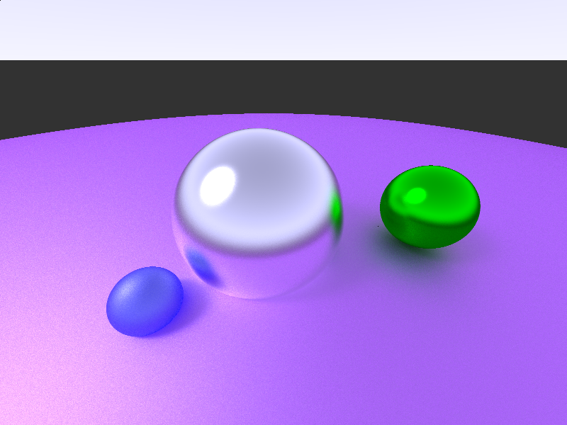

# Pathtracer

This is a simple multithreaded software pathtracer written in C and SDL that trace a simple scene with just spheres. I've *technically* implemented the Möller-Trumbore triangle tests, but they're not really ready yet.



## Try it out
Try it out [here](https://duckdood.github.io/terra/pathtracer/)

## Building locally (tested with GCC)
```
git clone https://github.com/DuckDood/pathtracer.git
cd pathtracer
make
```
This puts a `pathtrace` binary in the build/ directory.

## Credits
I mainly used the [Ray tracing in one weekend](https://raytracing.github.io/books/RayTracingInOneWeekend.html) book and [Sebastian lague's video about ray tracing](https://www.youtube.com/watch?v=Qz0KTGYJtUk) for this project, but I also used some wikipedia relating to matrix transforms and triangle-ray intersection tests.

## Technical info
It's mostly the same design as the ray tracing in one weekend book, but the light accumulation code is more similar to Sebastian Lague's video, using two variables to keep track of each ray's color rather than just one. For metallic surfaces, Sebastian Lague's video lerps between a diffuse and specular direction, whereas RT in one weekend jiggles a specular ray directly, and I decided to go with the latter, as it seems more physically based.
